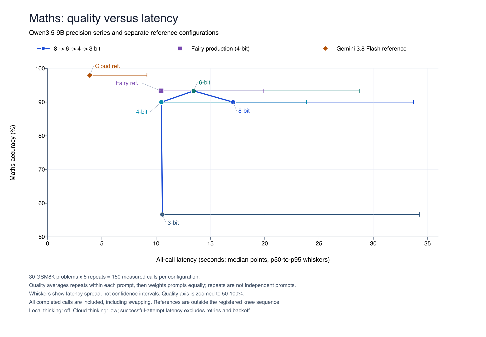
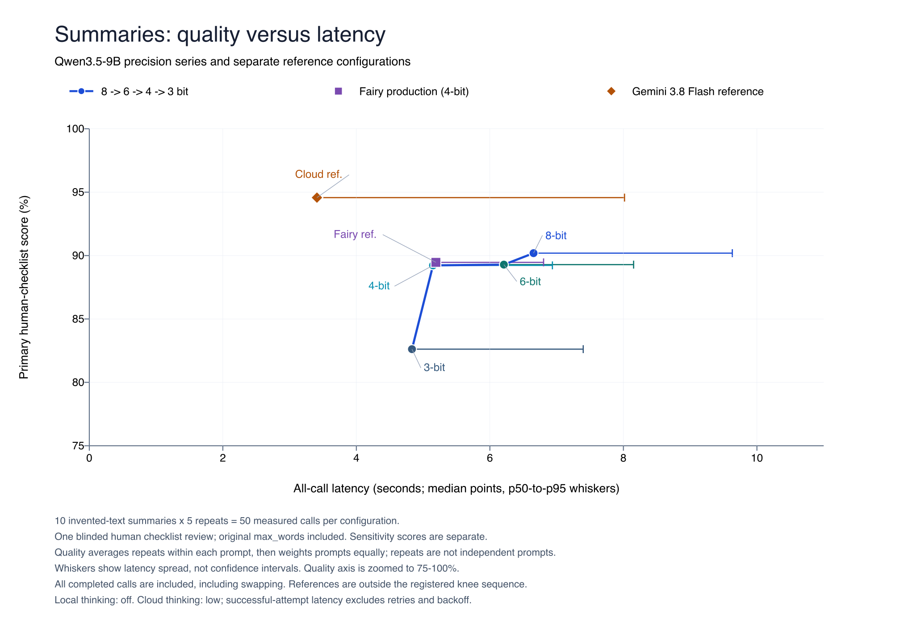

# CallCost for LLMs

Measure the hidden energy and memory cost of one LLM call on a constrained laptop.

CallCost measures single calls on a 16 GB Mac, comparing installed LM Studio configurations with a Google Gemini reference. The priority is on-device energy per call, then model GiB and swap, then latency and money. Answer quality is a secondary constraint on useful work. Energy is an estimate, whole-machine delta for CPU + GPU + ANE, not per-process or cloud-server energy.

## Status

The initial 17 October collection, blind human summary review, offline audit and published charts are complete. Those human scores remain primary and will never be rescored. The registered maths knee is 4→3 bit; no summary knee was found. Kill criterion 2 remains unmet because no actual Fairy deployment decision has changed. Provider-billing reconciliation and disclosed measurement gaps remain outstanding. Last recorded offline verification: 113 tests and Ruff pass.

**Presentation refocus, 17 October 2026, draft for review:** energy and memory now lead the presentation. This is not an amendment to the initial experiment. New priorities, recommendation rules and newly derived analyses are exploratory, not pre-registered. See the [agreed plan](docs/plan-2026-10-17.md), [saved-call cost inventory](docs/cost-inventory-2026-10-17.md) and [draft prospective judge protocol](docs/judge-preregistration.md). Week 1 is documentation and offline analysis here; no judge validation or app implementation has run. The WAICY target is a macOS local web app demo by 22 November. No model calls, downloads or system changes are authorized by this note; raw answers and review artifacts remain private under runs/.

The local family is Qwen3.5-9B in MLX format, with thinking off. The 3-, 4-, 6- and 8-bit variants have been independently converted from pinned official Qwen weights using mlx-lm 0.32.0 and group size 64. Each loads in LM Studio and passes a held-out thinking-off pilot. Fairy's existing 4-bit model is a fifth local configuration, labelled "Fairy's production model" and treated as a separate reference. See [model preparation](docs/model-preparation.md) for the inspected published candidates and conversion pins. The experiment config selects Gemini 3.8 Flash at thinking level low, with standard list prices checked on 15 October 2026. The 8-bit pilots had less than 1 GB available RAM, and sampled process RSS did not track total model memory; the collected run retains swapping as a configuration cost with explicit measurement limitations.

Fairy is a separate project. The initial summaries are Fairy-style prompts written for the benchmark (invented texts), not real Fairy usage. Fairy code and integration are outside this repository.

## Scope

Single calls in a fresh, empty chat: no conversation history, tools or context-length experiment. Existing requests do not carry earlier turns; conversation storage being off does not prove an empty server cache. These measurements represent single-task use. Longer chats may require more energy and memory, but were not measured; treating these results as a lower bound for chat use is a scope assumption, not an established numerical bound.

The planned WAICY app reads this Mac's chip, RAM, available memory and swap; uses the existing maths or summary tasks and installed LM Studio models; probes and recommends a local model. It is not implemented yet. Planned modes are Quick (5 prompts × 2 repeats, labelled rough), Standard (10 × 3) and Full (30 × 5); Full requires a task set with 30 distinct prompts, so the current ten-summary set cannot fill it. Recommendations use quality within five percentage points of the best local candidate, then the lowest median energy; warn above 50% swapped calls. These defaults were chosen after seeing the 17 October data: exploratory, not pre-registered, and user-adjustable. Missing energy must be disclosed rather than treated as zero. Probes take minutes and energy needs sudo-backed powermetrics; the video will use an earlier or sped-up recording.

New-run quality work is planned with DeepEval and a Gemini 3.8 Flash judge, subject to the prospective amendment and held-out validation below. Maths keeps deterministic exact-match scoring. The initial summaries were Fairy-style prompts written for the benchmark (invented texts); existing summary datasets and evaluation frameworks such as DeepEval were not used in those results.

**Dated operational clarification, 17 October 2026:** the 16 October separate-pass amendment below stops quota/rate-limit errors without retries. The later decision in `1b98743`, also recorded in AGENTS.md and HANDOFF.md, permits four extra HTTP 500/503 attempts with 10/30/90/270-second waits. Auth, billing and quota errors still stop immediately. This note clarifies operations without rewriting the frozen pre-registration text.

## Hypothesis

For a fixed task set, quality stays nearly flat across quantisation levels and then drops sharply at one step, while cost falls by a roughly steady amount per step. The knee can occur at different quantisation levels for different task types. The finding is the knee per task type, not a claim that local inference beats cloud inference.

## Pre-registration

These rules are recorded before the first full run. Any later amendment must be committed and identified in the results.

- Dataset: 30 reproducibly selected GSM8K test problems and 10 Fairy-style prompts written for the benchmark (invented texts). The summaries require owner review before any model sees them.
- Repeats: five measured calls per prompt per configuration. Warm-ups are additional and excluded from the results.
- Quality per configuration: mean score across prompts for that task type. Average repeated scores within each prompt first, so each prompt has equal weight.
- Knee, amended 15 October 2026: the first step after the baseline step where task quality falls by at least 10 percentage points AND at least twice the previous step's drop. Cost is not a gate. For every step, report weight-byte memory saving, sampled physical footprint as a secondary column, and p50 and p95 latency savings.
- Boundary convention: the first step down establishes the previous-drop reference and cannot itself qualify as a knee.
- Memory convention, amended 15 October 2026: descriptive memory savings use exact encoded tensor payload bytes for the loaded model. Sampled physical footprint and RSS remain secondary measurements. Neither is a knee gate.
- Swap convention, amended 16 October 2026: all completed answers contribute to quality and the knee regardless of swapping. All-call latency is primary; report swap-free latency separately, swapped-call share, unknown count and median swap volume. See the dated amendment below.
- Variance kill: if, for adjacent quantisation levels, the interquartile ranges of per-call latency overlap AND the quality difference is under 5 percentage points, the levels are treated as indistinguishable.
- If no step meets the knee definition for a task type, report **no knee found** for that task type.

Compare adjacent levels within the same local model family, ordered from highest to lowest precision. Gemini and Fairy's production model are reference points outside the four converted levels in the quantisation sequence. Percentage-point quality changes are distinct from relative percentage savings in latency and memory.

### Pre-registration amendment, 15 October 2026

Before any scored benchmark data, physical footprint was tested with Darwin `proc_pid_rusage`, `RUSAGE_INFO_V0`, `ri_phys_footprint`, sampled over the same LM Studio process group as RSS. Complete contemporaneous process-group samples were required. Valid 3-, 4- and 6-bit pilot peaks were 5,356,283,032, 6,471,723,096 and 8,655,694,824 bytes. They exceeded encoded weight bytes and increased with precision. Both 8-bit attempts lost process coverage during at least one in-call sample, so neither supplied a valid peak. Full validation therefore failed. The [validation record](docs/data/physical-footprint-validation.json) retains both attempts, errors and swap counters. These held-out calls are instrumentation checks, not benchmark results.

The initial memory fallback selected **loaded weight bytes**, defined exactly as the sum of encoded tensor payload lengths in the selected safetensors files, excluding headers, tokenizers and configuration files. This is a static weight-footprint proxy, not measured peak runtime memory. For the four text-only levels it is 3,918,948,864, 5,038,041,600, 7,276,227,072 and 9,514,412,544 bytes. With these exact weights, adjacent savings are 23.53% (8 to 6 bit), 30.77% (6 to 4 bit) and 22.21% (4 to 3 bit). Every step exceeded the original 20% limit, making that gate unsatisfiable for these levels. This is a constraint of the amended experiment, not empirical evidence that no runtime-memory knee exists. The superseding amendment below removes this gate. Context length and cache settings remain fixed across levels; this proxy does not measure runtime cache or activation allocation. Keep sampled physical footprint and RSS in separately labelled columns with missing-value reasons. Fairy retains 912,020,960 encoded vision-weight bytes and remains outside the knee sequence.

Historical policy, superseded by the 16 October amendment below: record whole-machine `vm_stat` swap-ins, swap-outs and pageouts around every call, in pages and bytes. Flag a call if any counter increases. Retain and report these calls, but exclude them from every quantity used in knee analysis, including latency, quality and variance. Missing or reset counters also make a call ineligible, with a separate unknown count. Report eligible counts per prompt and configuration; do not treat missing prompts or an empty eligible group as zero quality or evidence of no knee. All validation pilots recorded swap activity, so a fresh, quiet launch remains necessary.

### Superseding pre-registration amendment, 15 October 2026

Before the first scored benchmark and before the unattended launcher smoke test, remove the original memory-saving and latency-saving gates. The exact weight-byte savings at every adjacent precision step exceed 20%, so the memory gate is unsatisfiable by construction for this series. A runtime-footprint gate would also depend on fixed process overhead. Decode latency on Apple Silicon may reflect memory bandwidth, making a proportional cost reduction plausible; this is a motivation, not a measured result. Earlier excluded model-preparation and instrumentation pilots exist; no task-set benchmark data has been collected.

The revised hypothesis is that task quality stays nearly flat across levels and then drops sharply at one step, while cost falls by a roughly steady amount per step. The knee is the first step after the baseline step where quality falls by at least 10 percentage points AND at least twice the previous step's drop. The baseline step cannot qualify. Cost is no longer a gate: show weight-byte memory saving, measured physical footprint as a secondary column, and p50 and p95 latency savings for every step. The variance rule and both kill criteria remain unchanged. If no eligible step meets the quality rule, report **no knee found**; missing eligible data or outstanding human scores are **insufficient data**, not evidence of no knee.

### Thinking pre-registration amendment, 15 October 2026

Before any scored benchmark data or launcher smoke data, clarify the thinking policy: thinking is off for all local configurations (the quantisation series and Fairy's reference). The cloud reference runs at `gemini-3.8-flash`'s lowest available level, `thinking_level: low`, because this model cannot disable thinking. Its thinking tokens are reported separately and included in billable output. The cloud is a reference point outside the knee calculation, so this does not affect the knee rule. This supersedes the earlier requirement that cloud thinking be disabled and aligns the method with the recorded cloud configuration. Excluded local preparation and instrumentation pilots already exist.

### Swap and separate-pass pre-registration amendment, 16 October 2026

Before any scored benchmark data, supersede the 15 October swap exclusion. Excluded preparation/instrumentation pilots and a held-out launcher smoke already exist; no benchmark prompts have been used. Swapping is part of the resource cost of a configuration on this 16 GB Mac, not a reason to discard its completed answer. All completed calls, including swap-active and swap-unknown calls, contribute to quality, quality-only knee analysis and the registered variance rule. Failures and pending human scores retain their existing treatment; temperature 0 still does not guarantee identical answers. The knee thresholds, first-step convention and both kill criteria are unchanged.

Record per-call whole-machine swap-in and swap-out page deltas from `vm_stat`, multiplied by the reported page size to obtain bytes. Record `vm.swapusage` used bytes and physical compressor memory (`Pages occupied by compressor` times page size) before and after every call, retaining raw readings and missing/reset-counter reasons. Pageouts remain separately recorded but do not alone establish swap activity. Swap volume means swap-in plus swap-out bytes, not net growth in swap storage. Missing counters are unknown, never zero.

Report latency p50/p95 for all completed calls and separately for calls with known zero swap-in and swap-out deltas. Report the swapped-call share among calls with known counters, the unknown count and median swap volume across calls with known counters for each configuration. All-call latency supplies the primary adjacent cost comparisons and the unchanged latency-IQR variance rule; swap-free latency is a labelled secondary view. Unknown swap counters do not remove completed answers from quality. These system-wide measurements can include background activity and are not per-process attribution.

Collect the five local configurations in an independently resumable local pass and the single Gemini reference in an independently resumable cloud pass. Both retain the same approved 40 prompts, five measured repeats, fixed settings, pilots and warm-ups. Preserve pass identity, input/source hashes and separate pointers/checkpoints. The cloud and Fairy reference remain outside the four-level knee sequence. A cloud quota/rate-limit error stops the pass with a clear status and retained attempt, without an automatic retry loop. Splitting collection changes neither the knee rule nor the reference roles; timestamps and conditions expose the different collection windows.

### Energy instrumentation amendment, 16 October 2026

Before any benchmark data, a held-out required-energy pre-check stopped after its first completed 3-bit call. All 48 raw power records parsed, but receipt-based interval reconstruction created apparent overlaps up to 18.6 ms and the existing 10 ms overlap guard correctly rejected the energy estimate. The original failed run and completed response remain unchanged; an offline replay is a diagnostic, not a passed live validation.

Require powermetrics `is_delta: true` and reconstruct successive intervals from reported `elapsed_ns`, anchored to the first sample receipt. Retain each actual receipt and its lag from the reconstructed end. Reject timing drift of at least half a reported interval, which guards against treating a missed full interval as continuous coverage. Parser failures invalidate attribution. The first receipt has unknown fixed delivery delay, so call-boundary attribution remains approximate. The existing two-sample, 90% coverage and 10 ms overlap guards remain unchanged. This is an instrumentation correction to the estimate, whole-machine delta; it changes no quality, knee, variance or swap rule. A fresh held-out validation needs owner authorization; completed calls are not silently repeated or relabelled.

### Kill criteria

If quality and cost fall together smoothly with no knee, or run-to-run variance is larger than the difference between quantisation levels, the hypothesis fails and the README will say so. The registered variance rule above determines when adjacent levels are indistinguishable.

If running the tool on Andrii's own projects changes no decision, with no model swapped, no quantisation changed and nothing moved between local and cloud, the tool has failed at its purpose and the README will say so.

## Measurements

| Metric | Definition |
| --- | --- |
| Total latency | Client wall-clock time from starting a request to completing the response, using a monotonic clock. |
| TTFT | Time until the first non-empty answer-text chunk arrives. This is client-observed TTFT; streaming chunks need not contain one token. |
| Tokens | Provider-reported input, output and reasoning counts, with their source retained. |
| Decode tokens/s | Provider-reported generation rate where available. A client delivery estimate must be separately labelled. |
| Model load time | Explicit load-request duration, recorded separately from call latency and linked to calls by load event. |
| Loaded weight bytes, descriptive | Exact encoded safetensors tensor payload bytes, not runtime peak memory. |
| LM Studio physical footprint peak, sampled, secondary | Largest complete contemporaneous process-group sum of `ri_phys_footprint`; invalid when process coverage is incomplete. |
| LM Studio RSS peak, sampled, secondary | Largest sampled sum of resident memory across identified LM Studio and inference-worker processes. |
| Payload bytes | Serialized request and received response body sizes, including streaming framing, excluding headers and transport overhead. |
| List-price equivalent | Input and billable output tokens multiplied by the prices recorded in config. Thinking tokens count when billed as output. |
| Energy, estimate, whole-machine delta | Integrated on-device power above an idle baseline, with the actual measured power domains recorded. |

Local loopback payloads are not zero bytes, although external inference traffic is approximately zero. Local API charges are zero, which does not imply electricity or hardware are free. Gemini list-price cost is reported even when development uses the free tier.

Cloud-side energy is not measured or estimated. Any energy collected during a Gemini request describes this Mac's client activity only.

Missing measurements are recorded as unavailable with a reason, never silently replaced with zero.

## Method

Run one request at a time. Keep temperature, output budget, context length and local inference settings fixed. Record the exact model files, quantisations and effective load settings. The four experimental precisions are separately installed text-only MLX conversions of the same pinned checkpoint using the same converter and group size. The existing production reference retains its original conversion and vision support, so it is excluded from the four-level knee calculation.

Use LM Studio's REST API to list, load and unload models. Disable prompt/KV cache reuse between calls if the API provides a supported control. If it does not, label the first measured appearance of each prompt separately from its four repeats and report both groups. Neither label proves the underlying cache state. Conversation storage and prompt caching are different mechanisms.

Thinking is off for all local configurations, both the quantisation series and Fairy's reference, using LM Studio `reasoning: "off"`. A held-out local pilot must show zero reasoning tokens and no reasoning content or `<think>` tags before measured calls begin. Missing local evidence stops the run. Preserve the setting, observed counts, evidence source and pilot call ID in metadata, and check every later local call too. The cloud reference runs at `gemini-3.8-flash`'s lowest available level, `thinking_level: low`, because this model cannot disable thinking. Its thinking tokens are reported separately and included in billable output. The cloud is a reference point outside the knee calculation, so this does not affect the knee rule.

Record hardware, CPU/GPU core counts, RAM, macOS and LM Studio versions, timestamp, charger state and readable thermal information. Preserve configuration and prompt hashes, software version and the randomisation seed.

Report median (p50) and p95 per configuration per task type, with sample and failure counts. Keep raw per-call data in CSV and run metadata in JSON. Preserve measurement samples so derived numbers can be checked.

Log when repeated calls for the same prompt and configuration produce different answer text. Per configuration and task type, report the number of prompts with more than one distinct answer, alongside the number of prompts compared and any incomplete repeat groups. Compare exact answer text, including whitespace, and preserve the differing call IDs and answers. This counts output variation, not necessarily a change in correctness or evidence of a particular cause.

Automatic quality checks run first. Blind human review shuffles answers, hides configuration and timing, and records checklist decisions separately. Unreviewed criteria remain pending. Maths scoring checks the numeric final line with a declared decimal tolerance and logs parseability separately. No LLM is the primary judge.

See [the measurement method](docs/methodology.md) and [the implementation plan](docs/implementation-plan.md).

## Reproduction

Use Python 3.12 or newer on macOS:

```sh
python3 -m venv .venv
.venv/bin/python -m pip install '.[dev]'
PYTHONPATH=src .venv/bin/python -m callcost models
PYTHONPATH=src .venv/bin/python -m callcost validate --prompts datasets/gsm8k/prompts.json --config configs/private/experiment.yaml
PYTHONPATH=src .venv/bin/python -m callcost run --prompts datasets/gsm8k/prompts.json --config configs/private/experiment.yaml --output runs/pilot-001 --pilot-only
PYTHONPATH=src .venv/bin/python -m callcost run --prompts prompts/private/dataset.yaml --config configs/private/experiment.yaml --output runs/experiment-001
.venv/bin/pytest -q
```

See the [pilot validation record](docs/pilot-validation.md) for what has and has not been exercised on this Mac.

Commands above use the current checkout source. A previously installed `.venv/bin/callcost` can contain an older packaged version; the launcher also explicitly uses checkout source.

Copy `configs/example.yaml` to `configs/private/experiment.yaml` and fill every placeholder. Quote `"off"` in YAML. Supply exact LM Studio keys and quantisation names from `callcost models`; list all model weight, configuration, tokenizer and template files so they can be hashed. Relative file paths resolve against the config directory. The REST API does not prove that this supplied file list belongs to the selected model; check that mapping against the installed directory before a run.

The output directory must not exist. Each run saves `calls.csv`, `metadata.json`, exact request/response bodies and instrument samples under `raw/`. It prints progress and the answer-variation count per configuration/task. Saved-run reports include p50/p95 costs, quality across all completed answers and adjacent step comparisons; human checklist scores remain pending until imported from blind review. Pilot and warm-up rows are retained but excluded from measured repeats. Any provider or thinking-verification failure stops the run, preserves partial evidence and returns non-zero; calls are never retried silently.

LM Studio must already be running with its local server enabled and existing model instances unloaded. CallCost only unloads the instance it loaded. Set the configured Gemini credential environment variable before running; credentials are not written to run artifacts. Input and output text are saved locally, so treat run directories as private unless deliberately publishing them.

Energy is optional by default. If you want power measurement, run `sudo -v` yourself immediately before the benchmark. CallCost invokes only the collector through `sudo -n`; it never prompts for a password and the benchmark stays unprivileged. Without access or supported samples, energy remains unavailable. `required_powermetrics` stops the run when collection cannot start or establish a baseline. See [measurement details](docs/methodology.md) for coverage and scope limits.

Before a full run, review the [completed preparation and its measurement limits](docs/model-preparation.md), use the registered weight proxy and check 8-bit headroom, fill in exact model identifiers and verified Gemini prices, fix the thinking setting, complete owner review of the ten invented-text summaries and their checklists, and validate the complete 40-prompt dataset. Credentials are read from environment variables and never committed.

The committed [GSM8K sample](datasets/gsm8k/prompts.json) records original zero-based test-row indices. Rebuild it with `python3 scripts/prepare_gsm8k.py`. The [selection manifest](datasets/gsm8k/selection.json) pins the source commit, source SHA-256, row indices and stable hash-ranking procedure using seed 2027. Its upstream licence is retained alongside the sample. The ten Fairy-style prompts written for the benchmark (invented texts) are in `prompts/summarisation.yaml`. Owner review was confirmed on 15 October 2026. The ignored `prompts/private/full.yaml` contains all 40 approved prompts and passes the full-dataset guard, including pinned maths identity. The launcher validates this input; it does not merge files. Collection and imported-review status are recorded in HANDOFF.md; selected aggregate results are published below, while raw run artifacts remain private.

Run artifacts and private prompt files are ignored by Git by default. Publish only deliberately selected artifacts.

## Results (17 October 2026)

**In short:** On this 16 GB Mac, 8-bit and 6-bit swapped on 73.5% and 79.0% of measured calls, compared with 25.5% at 4 bit, and were slower than 4 bit without a meaningful quality gain under the registered adjacent comparisons. Whole-machine counters cannot prove inference alone caused the swapping or latency differences. Four bit has the lowest observed median energy among quality-eligible local configurations for both tasks, but missing 6-bit energy prevents a definitive full-data recommendation. These are initial single-call results, with unchanged human summary scores; no real Fairy deployment decision has changed.

Collection on 16 and 17 October used one M1 Pro Mac with 16 GB RAM. Each configuration completed 150 measured maths calls (30 problems, five repeats) and 50 summary calls (10 invented texts, five repeats). Pilots and warm-ups are excluded. Repeated scores are averaged within each prompt before averaging across prompts; repeats do not increase the number of independent tasks.

On this 16 GB Mac, 8- and 6-bit median latency exceeded 4 bit on both tasks, with no meaningful quality gain under the registered adjacent comparisons. Whole-machine swap activity occurred during **147/200 (73.5%)** measured 8-bit calls and **158/200 (79.0%)** 6-bit calls, compared with **51/200 (25.5%)** at 4 bit; all counters were known. By task, the shares were 79.3% maths / 56.0% summaries for 8 bit and 84.0% / 64.0% for 6 bit. Among the 8-, 6- and 4-bit levels, 4 bit had the lowest median latency on both tasks without the 3-bit quality loss. Three bit was faster on summaries but lost quality; its maths median was slightly slower than 4 bit. Swapping is part of the configuration cost on this Mac, but these whole-machine counters cannot prove that inference alone caused it or the latency difference.

Cloud reliability: **16 of 203 completed cloud calls needed automatic retries for HTTP 503**, requiring 17 retry attempts. An earlier HTTP 503 also stopped the pass before the retry policy was added; that checkpoint was completed after resume. Thus there were 18 failed HTTP attempts in total, all retained, and all 203 slots ultimately completed (200 measured, one pilot and two warm-ups). None of the 1,015 local calls failed to respond (1,000 measured, five pilots and ten warm-ups). These are response-reliability counts, separate from answer correctness.

### Energy and memory first, exploratory presentation on 17 October 2026

The [cost inventory](docs/cost-inventory-2026-10-17.md) gives energy p50/p95, availability and reasons, weight GiB and sampled footprint coverage, per-task swap, all-call/swap-free latency, payloads and money for all six configurations, with source file paths. The metrics retain their original measurement definitions; the new presentation and recommendation are exploratory, not pre-registered.

| Local configuration | Weight GiB | Maths energy median / p95 J (available / 150) | Summary energy median / p95 J (available / 50) |
| --- | ---: | ---: | ---: |
| 8 bit | 8.8610 | 263.42 / 507.74 (150) | 119.12 / 162.93 (50) |
| 6 bit | 6.7765 | 316.88 / 654.02 (65) | 149.51 / 197.92 (21) |
| 4 bit | 4.6920 | 213.47 / 481.93 (150) | 109.41 / 141.38 (50) |
| 3 bit | 3.6498 | 231.60 / 761.11 (150) | 107.91 / 163.52 (50) |
| Fairy's production model | 5.5414 | 225.26 / 425.55 (150) | 112.74 / 147.51 (50) |

Energy is **estimate, whole-machine delta**, CPU + GPU + ANE above a loaded idle baseline. Cloud energy and local weight/footprint are unavailable, not zero; cloud-server energy is outside scope. Q6 lost 85 maths and 29 summary energy observations to the collector guard. GiB is an exploratory conversion of descriptive encoded weight bytes, not runtime peak memory; Fairy includes vision weights. Footprint coverage and uncertainty are in the inventory.

Applying the app's post-data rule selects 4 bit on observed energy for both tasks; 3 bit falls outside the five-point quality band. Four bit has no >50% swap warning on either task. Excluding incomplete q6 energy leaves that observed pick unchanged, but the missing majority could change q6's full-sample median. This is a provisional check, not an actual Fairy deployment decision or a satisfied kill criterion 2.

### Registered secondary quality and knee findings, unchanged



Maths: 30 independent problems × five repeats = 150 calls per configuration. The line connects 8→6→4→3 bit at median latency; each horizontal whisker runs from p50 to p95, not a confidence interval. Fairy and cloud are separate reference points outside the knee calculation. All completed calls, including swapping, contribute. The quality axis starts at 50%.



Summaries: 10 independent prompts × five repeats = 50 calls per configuration, scored using one blinded human review and the automatic checklist checks. The primary score includes `max_words`. The line and whiskers use the same conventions as maths; the quality axis starts at 75%. Local thinking is off; cloud thinking is low. Cloud latency measures successful attempts and excludes failed attempts and retry waits.

| Configuration | Maths accuracy | Summary primary, including max_words | Summary sensitivity, excluding max_words |
| --- | ---: | ---: | ---: |
| 8 bit | 90.00% | 90.19% | 92.33% |
| 6 bit | 93.33% | 89.29% | 92.33% |
| 4 bit | 90.00% | 89.23% | 92.33% |
| 3 bit | 56.67% | 82.62% | 81.00% |
| Fairy's production model | 93.33% | 89.46% | 92.90% |
| Cloud reference | 98.00% | 94.57% | 98.47% |

For maths, the registered quality-only knee is **4→3 bit**: accuracy drops 33.33 percentage points, compared with 3.33 points at the preceding step. Under the registered variance rule, 8→6 and 6→4 are indistinguishable: their latency interquartile ranges overlap and their quality gaps are under five points. The 4→3 step is distinguishable. Its median latency rises slightly, from 10.48 to 10.58 seconds, while encoded weight bytes fall 22.21%. Cost is not a knee gate, and these observations do not establish a roughly steady latency saving at every step. Of 150 measured 3-bit maths answers, 85 are correct, 20 are parseable but wrong and 45 have unparseable final answers; unparseable answers are not all demonstrated mathematical errors.

For summaries, **no knee found** under the registered rule. Primary quality drops by 0.90, 0.06 and 6.61 percentage points across the three adjacent steps. The first two are indistinguishable under the variance rule; the last is distinguishable but does not reach the ten-point knee threshold. These are task-specific findings, not a general ranking of local and cloud inference.

The registered hypothesis predicted task-dependent knees. Maths shows a knee at 4→3 bit, while summaries show none at the same step or elsewhere in this sequence. This is **consistent with the registered hypothesis on this task set**, not proof; the roughly steady cost-reduction part is not established. **Kill criterion 1 is not triggered:** the data do not show only smooth quality/cost declines without a knee, and the registered variance rule does not erase the maths knee. The indistinguishable higher-precision steps remain explicitly reported above.

Exact answer text varies across repeats despite temperature 0. No local configuration varies on the 30 maths problems; cloud varies on all 30. For summaries, the numbers of prompts with varying text are 2, 1, 3 and 0 out of 10 for 8, 6, 4 and 3 bit, respectively; Fairy varies on 0 and cloud on 10. Text variation does not necessarily change correctness. The saved audit reports all-call and swap-free latency side by side; the charts use the registered all-call view.

**Prompt deviation, recorded 17 October:** the summary file from `6f6de97` ran with tight short-form instructions (mostly two or three sentences) and automatic length checks of 50 to 90 words. A longer-limit revision was intended but never committed or run. Every configuration received identical prompt content and checklist rules. The pre-registered score including `max_words` remains primary; the secondary column removes only that check and reweights the remaining criteria. It rescores existing answers and does not estimate answers to the intended longer prompts. No reruns were made.

Interpretation is limited by 30 public maths problems, 10 invented summary texts, one human summary review by the project author without an inter-rater check, one device and separate local/cloud collection windows. Public GSM8K questions may have appeared in training. Thinking settings differ between local and cloud. Whole-machine swap can include background activity, and thermal conditions can affect latency. Energy is unavailable for 114 of 1,000 measured local calls because the timing-drift guard rejected samples during the long run; the shorter pre-check had valid samples. Sampled process memory is unavailable for 255 local calls because coverage was incomplete. These are measurement gaps, not zero costs. Cloud client energy was deliberately not reported because background noise dominates attribution; cloud server energy is outside scope. List-price costs exclude tax; provider billing and VAT applicability remain unreconciled.

**Kill criterion 2 is currently unmet.** The registered criterion says: “If running the tool on Andrii's own projects changes no decision, with no model swapped, no quantisation changed and nothing moved between local and cloud, the tool has failed at its purpose and the README will say so.” No actual Fairy model, quantisation or local/cloud deployment decision has changed in the recorded evidence. The benchmark findings alone do not satisfy this practical-usefulness criterion.

Chart sources are the [aggregate snapshot](docs/data/results-20261017.json), with saved-report hashes, and [offline plotting script](scripts/plot_results.py). Vector exports: [maths SVG](docs/figures/quality-cost-maths.svg), [summary SVG](docs/figures/quality-cost-summarisation.svg); print exports: [maths PDF](docs/figures/quality-cost-maths.pdf), [summary PDF](docs/figures/quality-cost-summarisation.pdf).

## Limitations

- Initial summary evaluation: the texts were invented; existing summary datasets and evaluation frameworks such as DeepEval were not used. DeepEval has not yet been installed or validated for new runs.
- Review and prompt authorship: the single human summary reviewer is the project author, blinded to configuration labels during review. The summary prompts were drafted with an AI assistant. There is no independent reviewer or inter-rater agreement measurement.
- Sample size: 30 maths problems and 10 summaries are a small task sample, and five repeats do not create five times as many independent problems.
- Single device: results describe this Mac and do not support generalisation to other hardware.
- Thermal throttling: a laptop's thermal and power state can change performance during a run despite controlled ordering and logged conditions.
- Determinism: temperature 0 does not guarantee identical answers on a GPU because floating-point results can depend on execution order, so some answers may differ across repeats; the frequency must be measured rather than assumed small.
- LM Studio overhead: measurements include its server, runtime and associated process overhead rather than isolating model computation.
- Energy: the energy column is an estimate, whole-machine delta, and the measured CPU/GPU/ANE domains may omit other components and differ from wall-socket power.
- Cloud energy: energy used by Gemini's servers is outside scope and is neither measured nor estimated.
- Sampled RSS can miss brief peaks, double-count shared pages and omit GPU/unified-memory allocations; the installed MLX pilot reported RSS below weight-file size, so RSS cannot establish that a model fits comfortably in RAM.
- Public benchmark questions may have appeared in model training data; GSM8K accuracy does not establish unseen-task reasoning ability.
- Cloud model updates, service load and network conditions limit exact reproducibility.

## References and boundaries

Methodological references are [MLPerf Inference](https://github.com/mlcommons/inference_policies/blob/master/inference_rules.adoc) and [MLPerf Client](https://mlcommons.org/benchmarks/client/), particularly their separation of quality and performance. This project does not claim MLPerf compliance.

Software Carbon Intensity is [ISO/IEC 21031:2024](https://www.iso.org/standard/86612.html). The Green Software Foundation announced [SCI for AI ratification in December 2025](https://greensoftware.foundation/articles/sci-ai-specification-ratified-standard-for-measuring-ai-emissions-across-the/). CallCost does not calculate a full SCI score or carbon emissions.

API references: [LM Studio REST](https://lmstudio.ai/docs/developer/rest), [Gemini generation and usage metadata](https://ai.google.dev/api/generate-content), and [Gemini pricing](https://ai.google.dev/gemini-api/docs/pricing). Dataset source: [GSM8K](https://github.com/openai/grade-school-math).

## Milestones

| Target | Deliverable and status |
| --- | --- |
| 25 October 2026 | Complete: LM Studio and Gemini runners, per-call CSV and run conditions, by 17 October. |
| 8 November 2026 | Complete: p50/p95 aggregation, terminal table, blind review and offline audit, by 17 October. |
| 22 November 2026 | Complete: first dataset results and charts, published 17 October. Provider-billing reconciliation remains pending. |
| 29 November 2026 | WAICY submission deadline supplied by the project owner. |
| 4 to 6 December 2026 | Finals and live Q&A dates supplied by the project owner. |
| 18 to 24 October 2026 | Refocus documentation and judge pre-registration; validation requires separate approval. |
| 22 November 2026 | New target: macOS web app, slides and recorded WAICY demo. |
| 15 December 2026 | Repository and chart freeze. CI budget mode and SCI units are deferred until after December. |

The published charts show quality against all-call latency, with the quantisation sequence connected and Fairy and cloud as separate reference points. CI budget mode and SCI units are outside the current plan until after December.

Current non-goals: self-built configurator, Fairy integration, model downloads, Windows/Linux support, tool use, long contexts, user-defined tasks, cloud energy estimates and a full SCI implementation. A local macOS web page recommending installed models is planned; it is not automatic production routing.

## Licence

MIT. See [LICENSE](LICENSE). Third-party datasets retain their own licence notices.

## Summarisation prompt review

`prompts/summarisation.yaml` contains ten Fairy-style prompts written for the benchmark (invented texts). Andrii confirmed review on 15 October 2026; the approved file is committed unchanged. Collection is complete and exported blind human scores were imported on 17 October 2026. Any additional inference requires separate approval. `max_words` counts whitespace-separated words with `len(answer.split())` and passes when the count is at most the integer limit. Regex checks accept `pattern` as an input alias for `value`. Automatic checks prefill only what they establish; human checklist items are filled from the imported blind review.

### Summarisation protocol deviation, 17 October 2026

What ran: `prompts/summarisation.yaml` as committed in `6f6de97`, with tight short-form instructions (mostly two or three sentences) and automatic `max_words` checklist limits of 50 to 90 words. These word limits are scoring criteria; the transmitted instructions retain their original wording. The prompt file and both runs' saved summary prompts/rubrics match. All five local configurations and the cloud reference received identical summary prompt content and were scored against the same checklist rules.

What was intended: a later revision with longer length allowances. That revision never reached the committed prompt file or the collected runs. This note records the deviation after collection; it does not retrospectively amend the pre-registration or change any prompt or response.

Summary results report both the **primary pre-registered score, including `max_words`**, and a **secondary post-collection sensitivity score, excluding only `max_words`**. For the secondary score, average the remaining checklist criteria within each answer, then average repeats within each prompt and give each prompt equal weight as before. Original sentence instructions and every other criterion remain unchanged. The primary score alone supplies registered quality, knee and variance conclusions. The secondary analysis rescores existing answers; it does not estimate responses to the intended longer prompts. Pending human criteria remain pending in both versions. No reruns are performed.

## Cloud reference configuration

`configs/experiment.yaml` contains all five local configurations and `gemini-3.8-flash` with `thinking: {thinking_level: low}`. Cloud thinking cannot be disabled for this model, unlike the local models. Thinking tokens are logged separately and included once in billable output. The requested level is recorded; the API does not expose proof of its internal reasoning depth. This difference limits direct interpretation of the cloud reference. See Google's [thinking documentation](https://ai.google.dev/gemini-api/docs/thinking).

The configured standard prices are USD 0.75 per million input tokens and USD 3.75 per million output tokens, including thinking. The run reports a list-price equivalent regardless of billing tier; paid billing requires owner confirmation and verification before the cloud pass. These rates apply through 31 December 2026 and double on 1 January 2027; update the config before a later run. Source: [Google pricing](https://ai.google.dev/gemini-api/docs/pricing), checked 15 October 2026. The launcher inherits `GEMINI_API_KEY` from Terminal; its presence was confirmed in an interactive login shell without printing it.

## Resuming after a run

The initial local and cloud passes are complete; do not resume them or repeat completed calls. For any separately authorized future resume, read the matching `runs/LATEST-local` or `runs/LATEST-cloud`, then that run's `status.json` and `run.log`; follow [HANDOFF.md](docs/HANDOFF.md). Resume local with `./scripts/run_full.sh --pass local --resume`, or cloud with `./scripts/run_full.sh --pass cloud --resume`. Read `runs/LATEST-local` or `runs/LATEST-cloud` first; `runs/LATEST` is only the most recently touched run. To produce a saved-run report without inference, from the repository root run:

```sh
PYTHONPATH=src .venv/bin/python -m callcost report --run "runs/$(cat runs/LATEST)"
```

## Separate local/cloud collection and paid-tier check, 16 October 2026

Neither command below is authorization to run. After the held-out pre-check, each full pass requires owner approval. Both use the same approved private 40-prompt input. The local pass has five configurations and 1,015 scheduled calls (1,000 measured, five pilots, ten warm-ups). Cloud has 203 (200 measured, one pilot, two warm-ups). The cloud remains outside the knee. Pass directories, saved hashes/checkpoints and `LATEST-local` / `LATEST-cloud` are independent.

```sh
./scripts/run_full.sh --pass local --config configs/experiment.yaml --prompts prompts/private/full.yaml
./scripts/run_full.sh --pass cloud --config configs/experiment.yaml --prompts prompts/private/full.yaml
```

The cloud reference smoke used 27 input tokens, five visible output tokens and 28 thinking tokens, hence 33 billable output tokens. At the configured USD 0.75/3.75 per million input/output, this is USD 0.000144 per smoke-size request, or **USD 0.029232 for 203 such requests**. This is a tiny-prompt extrapolation, not the full benchmark's price or a spending cap: actual input lengths and answers will differ. Thinking counts once in billable output. Resume adds only outstanding requests, plus any deliberately authorized new attempt after a failed request.

After the owner says billing is enabled, verify in Google AI Studio that the environment key belongs to the intended project, that project's paid plan/usage tier and active model limits, and the actual spend-cap setting. Record the project/tier/limits, evidence source and check time without storing the secret key before cloud approval. A model-metadata GET or a successful inference is not proof of a paid tier. See [Google billing](https://ai.google.dev/gemini-api/docs/billing), [key/project association](https://ai.google.dev/gemini-api/docs/api-key) and [active rate limits](https://ai.google.dev/gemini-api/docs/rate-limits). An [alerts-only budget](https://docs.cloud.google.com/billing/docs/how-to/budgets) does not itself cap spending; verify an actual [spend-cap budget](https://docs.cloud.google.com/billing/docs/how-to/budgets-spend-caps) if available for the project/account.

HTTP 402/429 or `PAYMENT_REQUIRED`/`RESOURCE_EXHAUSTED` (including exhausted prepaid balance) stops cloud collection with `rate_limited` status and a retained failed checkpoint/raw response. These errors are not retried. The 17 October decision in `1b98743` separately permits up to four retries for HTTP 500/503, with retained attempts and 10/30/90/270-second waits. Resolve quota/billing/rate limits, obtain approval for any new request, then resume explicitly. Never rerun completed checkpoints.

The authorized pre-check after the owner's clean restart is `sudo -v && ./scripts/run_full.sh --precheck`. It performs only three held-out calls each on local-q8/local-q3, idle swap diagnostics and required energy validation. It cannot start a full pass or send any benchmark prompt. Keep the Terminal and lid open; enter the sudo password only in Terminal. Pre-check and full-pass permissions remain separate.

## Prospective quality-policy amendment, 17 October 2026 (draft, not effective)

For runs collected after this amendment is approved, committed and pushed, an LLM judge may become the primary evaluator of human-type summary checklist items only after held-out validation under [judge-preregistration.md](docs/judge-preregistration.md). Required unweighted Cohen's kappa is at least 0.6; raw agreement is secondary. Cloud-answer agreement is assessed separately because Gemini 3.8 Flash also generated the cloud reference answers. If that stratum fails, it remains human-scored. Failed or undefined metric validation means summaries remain human-scored and the app demo uses maths only.

This prospective exception supersedes the no-primary-LLM-judge rule only for eligible future runs. It does not change the original pre-registration, hypothesis, knee, variance or kill criteria. The 17 October initial results and human scores will never be rescored or replaced. Using copies of those answers to validate a judge is a separate validation experiment, not a new score for the initial results. Exact maths and existing automatic checks remain deterministic. No model calls are authorized by this draft.
